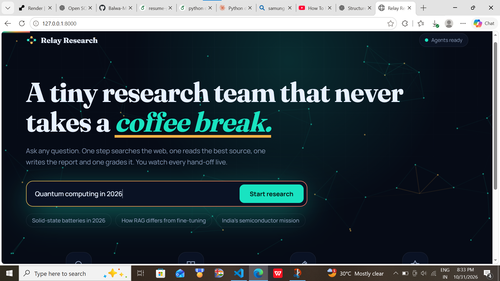
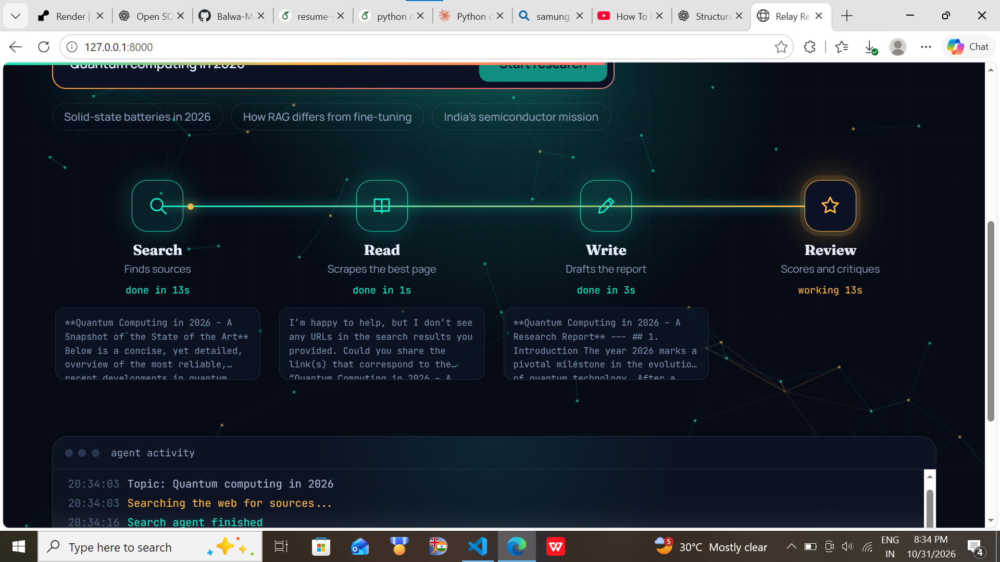
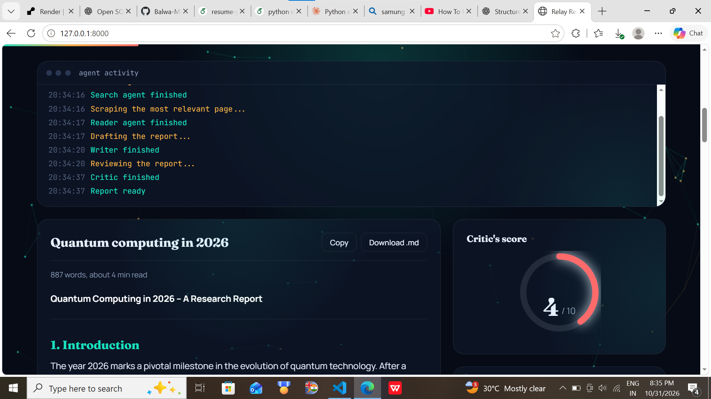
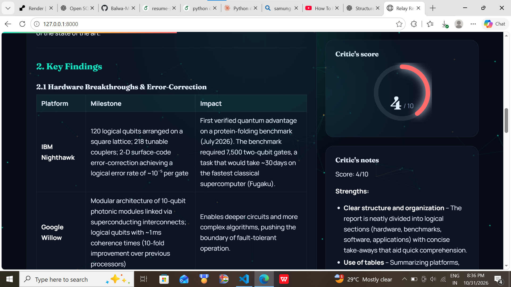
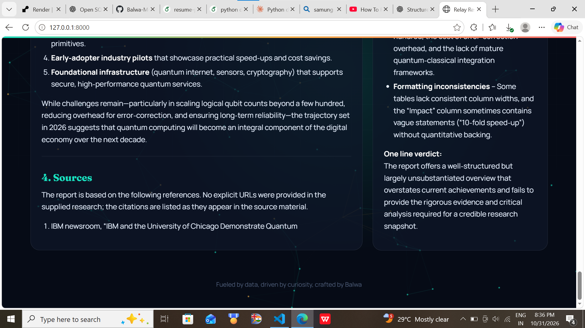

<p align="center">
  
</p>

<h1 align="center">Relay Research</h1>

<p align="center">
  A small AI research team that searches the web, reads a relevant source, writes a report, and critiques its own work.
</p>

<p align="center">
  
  
  
  
</p>

## See it in action

The interface streams each agent's progress, then presents the generated report, review, and source links.

<table>
  <tr>
    <td align="center"><strong>Live agent hand-offs</strong></td>
    <td align="center"><strong>Research report and score</strong></td>
  </tr>
  <tr>
    <td></td>
    <td></td>
  </tr>
  <tr>
    <td align="center"><strong>Findings and critique</strong></td>
    <td align="center"><strong>Report sources</strong></td>
  </tr>
  <tr>
    <td></td>
    <td></td>
  </tr>
</table>

## How it works

Enter a topic and Relay Research runs four steps in sequence:

1. **Search** — a LangChain agent uses Tavily to find up to five web results.
2. **Read** — another agent selects a relevant result and extracts page text.
3. **Write** — the language model creates a structured report with an introduction, key findings, conclusion, and sources.
4. **Review** — a critic evaluates the report, lists strengths and improvements, and gives it a score.

The browser shows each step as it runs. When the report is ready, you can copy it, download it as Markdown, revisit recent reports saved in your browser, and follow the source links.

## Quick start

### Requirements

- Python 3.11 or newer
- A [Groq API key](https://console.groq.com/keys)
- A [Tavily API key](https://app.tavily.com/)

### Install

From the project directory, create and activate a virtual environment, then install the dependencies:

**Windows (PowerShell)**

```powershell
py -3.11 -m venv .venv
.\.venv\Scripts\Activate.ps1
python -m pip install -r requirements.txt
Copy-Item .env.example .env
```

**macOS / Linux**

```bash
python3.11 -m venv .venv
source .venv/bin/activate
python -m pip install -r requirements.txt
cp .env.example .env
```

Add your API keys to `.env`:

```dotenv
GROQ_API_KEY=your_groq_api_key
TAVILY_API_KEY=your_tavily_api_key
```

Start the app:

```bash
uvicorn research_system.main:app --app-dir src --reload
```

Open [http://127.0.0.1:8000](http://127.0.0.1:8000) in your browser.

## API

The web app uses a Server-Sent Events endpoint to stream progress:

```text
GET /api/research?topic=your%20research%20topic
```

The `topic` parameter must contain between 3 and 300 characters. The stream reports step updates, then sends the completed report and critic feedback. The FastAPI interactive API documentation is available at [http://127.0.0.1:8000/docs](http://127.0.0.1:8000/docs).

## Project layout

```text
src/research_system/
├── agents.py       # Groq model, search/reader agents, writer and critic chains
├── main.py         # FastAPI app, web UI routes, and streaming research endpoint
├── pipeline.py     # Sequential command-line research pipeline
├── tools.py        # Tavily web search and page scraping tools
└── static/
    ├── index.html  # Web interface
    ├── script.js   # Streaming UI and report interactions
    └── style.css   # Responsive visual design
output/             # Screenshots used in this README
```

## Notes

- The search tool uses Tavily; the language model is `openai/gpt-oss-20b` through Groq.
- Page scraping depends on the selected site being reachable and allowing requests.
- AI-generated research can be incomplete or inaccurate. Check important claims against the linked sources.
- Keep API keys in `.env`; do not commit secrets.
